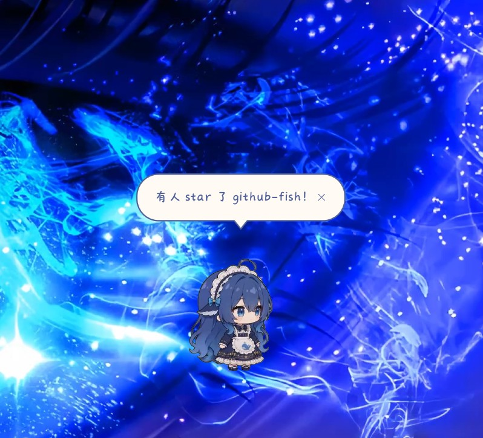

# 鲸鱼娘监控 GitHub 仓库

**让你的桌面鲸鱼娘替你看 GitHub。**

有人 star 你的仓库，她跳舞；CI 挂了，她垂头叹气；有人提了 issue，她凑过来念给你听。

你写代码的时候，桌角有个东西真的在"关心"你的进度。



*有人 star 了你的仓库，她就这么告诉你。*

> **本项目基于 [蓝色大肥鱼](https://github.com/Bai-Cute/big-blue-fish-desktop-pet) 的 MCP 接口开发。**
>
> - 原作者：**[Bai-Cute](https://github.com/Bai-Cute)**
> - 原项目：[Bai-Cute/big-blue-fish-desktop-pet](https://github.com/Bai-Cute/big-blue-fish-desktop-pet)（Apache License 2.0）
> - 桌宠形象、动画素材、人格设定的版权均归原作者所有
>
> 本项目是**独立的第三方程序**，不包含原项目的任何源代码或美术素材，仅通过原项目公开的 MCP 协议进行通信。使用前请自行安装原桌宠。
>
> 因为走的是标准 MCP 协议，任何支持 `say` / `play_action` 的桌宠都能接。

---

## 目录

- [它能做什么](#它能做什么)
- [基于什么开发](#基于什么开发)
- [怎么用](#怎么用)
- [配置说明](#配置说明)
- [它是怎么工作的](#它是怎么工作的)
- [常见问题](#常见问题)
- [致谢](#致谢--credits)

---

## 它能做什么

它每隔一段时间去看一眼你的 GitHub，发现新动静就让鲸鱼娘告诉你。

### 会播报的事件

| 事件 | 她会说什么 | 会做什么动作 |
|---|---|---|
| 有人 **star** 你的仓库 | 「XXX star 了 you/repo！」 | 雀跃庆祝 |
| 有人 **fork** 你的仓库 | 「XXX 把 you/repo fork 走了」 | 开心跃动 |
| 有人 **提 issue** | 「XXX 提了新 issue #3：README 截图挂了」 | 思考冒泡 |
| 有人 **关 issue** | 「XXX 关掉了 issue #3」 | — |
| 有人 **提 PR** | 「XXX 给 you/repo 提了 PR #7」 | 清点归档 |
| PR **被合并** | 「XXX 的 PR #7 被合并进 you/repo 了！」 | 清点归档 |
| 有人**发新版本** | 「XXX 给 you/repo 发了新版本 v1.2.0」 | 放烟花 |
| **CI 挂了** | 「you/repo 的 CI 挂了（build / main）」 | 垂头叹气冒汗 |
| **CI 过了** | 「you/repo 的 CI 过了！」 | 雀跃庆祝 |

### 几个特意做的细节

- **首次运行不炸屏**：第一次启动只建立基线，不会把你积压的 50 条历史通知一次性全喊出来。
- **状态持久化**：关掉重开不会重复播报同一条，靠 `state.json` 记事件 ID。
- **静默时段**：设好时间段，半夜没人 star 你也能睡个好觉。
- **CI 只在状态变化时播报**：记录每个仓库最近一次 workflow 的结论，成功转失败才说话，不会一直念。
- **动作可配**：什么事件配什么动作，全在配置文件里改，不用碰代码。
- **单实例保护**：重复启动不会起两份，第二次会说「我已经在盯着了」。

---

## 基于什么开发

| 项目 | 说明 |
|---|---|
| **语言** | Python 3.8+，**仅使用标准库，零第三方依赖** |
| **桌宠通信** | [MCP](https://modelcontextprotocol.io/)（Model Context Protocol）的 stdio 传输 |
| **数据来源** | GitHub REST API v3 |
| **驱动对象** | [蓝色大肥鱼](https://github.com/Bai-Cute/big-blue-fish-desktop-pet)，或任何支持 `say` / `play_action` 的桌宠 |
| **打包** | PyInstaller（单文件 exe，约 8.5 MB） |
| **许可证** | MIT |

### 为什么零依赖

只用 `urllib`、`json`、`subprocess`、`socket`、`threading` 这些标准库就够用了。

好处是：别人 clone 下来 `python github_fish.py` 直接能跑，**不用 pip 装任何东西**。对一个需要长期挂着的小工具来说，少一层依赖就少一堆"装不上"的求助。

### 它调用的两个 MCP 工具

| 工具 | 作用 |
|---|---|
| `say` | 让桌宠说出指定文字（带打字气泡） |
| `play_action` | 让桌宠播放指定动作动画 |

只要你的桌宠实现了这两个工具，把 `pet.bridge_exe` 指向它的 MCP 桥接程序就能用。

---

## 怎么用

### 前置条件

1. 装好 [蓝色大肥鱼](https://github.com/Bai-Cute/big-blue-fish-desktop-pet)（或同类桌宠）
2. 打开桌宠 → 右键 → 设置 → **Agent 与 MCP** → 勾上「开启 MCP 接口」

### 方式一：下载 exe（不装 Python）

1. 去 [Releases](https://github.com/jingdq11-web/whale-girl-github/releases) 下载 `github-fish.exe`
2. 放到一个固定文件夹，比如 `D:\whale-girl\`
3. **双击运行一次** —— 它会在同目录生成 `config.json`，然后自动退出
4. 用记事本打开 `config.json`，至少填这三项：

```json
{
  "github": {
    "user": "你的GitHub用户名",
    "repos": ["你的用户名/仓库名"]
  },
  "pet": {
    "bridge_exe": "D:\\deepseek\\蓝色大肥鱼\\BigBlueFish.Mcp.exe"
  }
}
```

5. **再双击运行** —— 鲸鱼娘会开口说「门卫上班了，我盯着 xxx 呢」

> exe 是**单文件、无窗口**的后台程序，运行后不会弹出任何界面。
> 想看它在干什么，看同目录的 `github-fish.log`。

### 方式二：从源码运行

```bash
git clone https://github.com/jingdq11-web/whale-girl-github.git
cd whale-girl-github
python github_fish.py          # 第一次会生成 config.json 并退出
# 填好 config.json 后再跑一次
python github_fish.py
```

### 停止

```bash
python stop_github_fish.py
```

它通过单实例锁占用的端口找到进程，**不会误杀其他 Python 程序**。

### 调试用参数

```bash
python github_fish.py --test   # 测试桌宠连接，不做轮询
python github_fish.py --once   # 只轮询一次，方便排查
```

---

## 配置说明

| 字段 | 说明 |
|---|---|
| `github.token` | Personal Access Token。留空也能用，但每小时只有 60 次请求 |
| `github.user` | 你的用户名，会监控你的公开事件流 |
| `github.repos` | 要监控的仓库列表，格式 `owner/repo` |
| `github.poll_interval` | 轮询间隔（秒），最低 30，默认 90 |
| `github.watch` | 每种事件是否播报，`push` 默认关（太吵） |
| `pet.enabled` | 是否驱动桌宠，关掉就只写日志 |
| `pet.bridge_exe` | 桌宠 MCP 桥接程序路径 |
| `pet.quiet_hours` | 静默时段，如 `[23, 8]` 表示 23 点到次日 8 点只记录不播报 |
| `pet.speak_prefix` | 每句话的前缀，比如填 `"乐，"` 就是「乐，有人 star 了！」 |
| `actions` | 事件类型 → 动作名，名字对不上就去桌宠里查准确名称 |

### 关于 token

不填也能跑，但 GitHub 对未认证请求限制 **每小时 60 次**。监控多个仓库、间隔又短的话很容易撞上限。

生成方式：GitHub → Settings → Developer settings → Personal access tokens → **Fine-grained tokens** → 只勾 `public_repo` 读权限就够（私有仓库才需要 `repo`）。

---

## 它是怎么工作的

```
GitHub REST API
      │  每 90 秒轮询一次
      ▼
   事件列表 ──► 去重（state.json 记录已处理的事件 ID）
      │
      ▼
   事件类型匹配 ──► 生成播报文案
      │
      ▼
   MCP stdio ──► say（说话） + play_action（动作）
      │
      ▼
    鲸鱼娘在桌面上开口
```

核心就三件事：**定时去看、判断有没有新东西、让桌宠说出来。**

没有魔法，也没有后台服务，就是一个挂在后台的 Python 进程。

---

## 常见问题

**Q：一直提示 MCP 握手失败？**
A：桌宠没启动，或者设置里没开 MCP 接口。桥接程序不会自己拉起桌宠。

**Q：动作没反应，但话说了？**
A：动作名对不上。用桌宠的 `list_actions` 查准确名称，然后改 `config.json` 里 `actions` 的值。

**Q：第一次运行什么都没播报？**
A：正常，首次运行只建立基线。之后有新事件才会说话。

**Q：exe 双击没反应？**
A：它本来就是无窗口后台程序。打开同目录的 `github-fish.log` 看它在做什么。

**Q：能开机自启吗？**
A：Windows 上把启动命令丢进 `shell:startup` 目录即可（做一个 `.vbs` 用 `pythonw.exe` 静默启动）。

**Q：支持 macOS / Linux 吗？**
A：源码版理论上可以，但没测试过；exe 只支持 Windows。

---

## 致谢 / Credits

### 上游项目

本项目的存在前提是 **[蓝色大肥鱼（Big Blue Fish）](https://github.com/Bai-Cute/big-blue-fish-desktop-pet)**。

| | |
|---|---|
| **原作者** | [Bai-Cute](https://github.com/Bai-Cute) |
| **项目地址** | https://github.com/Bai-Cute/big-blue-fish-desktop-pet |
| **许可证** | Apache License 2.0 |
| **本项目使用的部分** | 公开的 MCP 接口（`say`、`play_action`）与其动作名称 |

**明确的边界：**

- 本项目**没有**复制、修改或再分发原项目的任何源代码
- 本项目**没有**包含原项目的任何美术素材（动画 WebM、图标、角色立绘）
- 本项目**没有**修改原项目的运行时
- 桌宠的形象、动画、人格设定、台词，版权全部归原作者
- 本项目仅通过原作者主动开放的 MCP 协议与其通信，属于对公开接口的正常调用

如果你喜欢这个项目，请先去给[原项目](https://github.com/Bai-Cute/big-blue-fish-desktop-pet)点个 star——
**没有那条鱼，这个项目根本不存在。**

### 本项目

由 [jingdq11-web](https://github.com/jingdq11-web) 开发，MIT License。

---

## License

MIT
